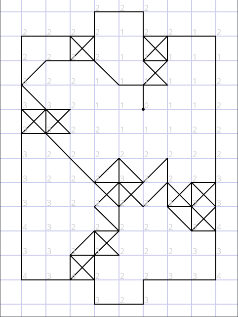
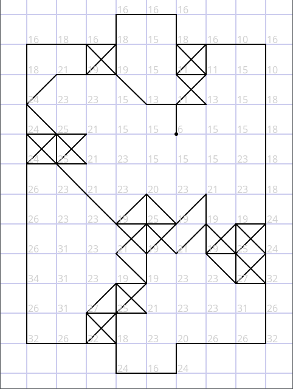
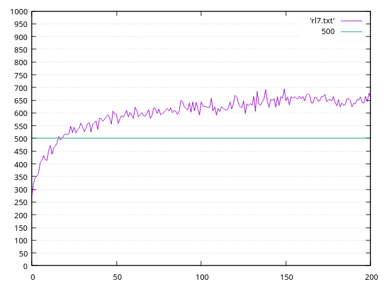

# Paper Soccer

Paper Soccer is paper and pen game. It was the first serious game that I was learning writing the AI player for. It was in ancient times when minimax was standard choice and mcts (with random playouts) were tried in more and more games. Now that I look back, maybe it wasn't good choice for first game to learn, there was not (and still isn't) much material on it. I haven't found any serious paper on it, most projects were some small hobby programs and their level was very weak. I learned a lot when writing just board representation and move generation. Paper Soccer is implemented using graph theory, and many quirks used in graph theory apply here. Actually only by writing the bot for this game I truly grasped concepts of path finding (DFS, BFS, Dijsktra etc.) algorithms.

At first I was trying minimax for Paper Soccer, but results were weak to say the least. No obvious evaluation exists that could be written in the form of simple rules, because going to opponent goal mindlessly isn't helpful. Not to mention that due to line bouncing, there can be enormous branching factor, with hundreds or even thousands per ply per player. Mcts with semi random games was better and the bot seemed to have some form of plan and was more aware of the situation in the board.

Years ago I was testing this mcts bot in [kurnik.pl (playok.com)](https://www.kurnik.pl) because it is the biggest site for paper soccer enthusiasts, against human players. It could achieve yellow rank (1500+) and with much luck and series of win, even orange (1800+) for a moment, so its strength was of some weak to intermediate player. 

Obviously during my adventures of playing around neural networks I also tried NN for Paper Soccer, but for some reason I couldn't make them work. I withheld trying NN for Paper Soccer for some years, but at some point I tried again, this time for serious. The reason it didn't work were heavy bugs that prevented it from playing and learning at all, like switching players during move or wrong result backpropagation. Had I figured it out then, I would have had workable NN for Paper Soccer years ago. When the NN finally worked, I was astonished by the strength of the bot. Soon it achieved over 95% winrate against the mcts bot in very quick games, and something like 99% in a more sane time controls.

The simplest inputs, like drawn edges and ball position were weak. For that to work I would need to use CNN or maybe graph neural network. So of course I made additional inputs. That is the 'true' distances from the ball to all nodes, the number minimal turns to reach the node if both players were trying to reach it:

The inputs are: 316 edges wether drawn (1) or not (0), and position from the ball to the other nodes in one-hots inputs fashion, so the picture shows the indexes of activated inputs. So there are 316 + 105 x 8 = 1156 inputs (I made the max of the distance 7). The network always sees from perspective of first player (with his goal at the bottom), so if this is second player's turn, I rotate the board by 180 degrees.

Once again I put the bot to test in kurnik. And lo and behold, it achieved the red (2100+) ranking easily, beating strongest players most of the time, sometimes losing in kind of stupid way. Even the best player of rank around 3000 can beat him in only less than half matches. Feels like AlphaGo moment. The bot seems already superhuman and I'm just one guy working on it as a hobby. When I started my journey with AI, mastering Go by computers was distant perspective, and having at least reasonable Paper Soccer bot seemed impossible.

I remark I use bigger network (2 hidden layers 192 and 32) than on codingame, few seconds per move and several threads. The version on codingame is smaller (2 hidden layers 32 and 32), uses only 200ms and 1 thread, it leads a lot in the leaderboard and I think even that version could easily achieve the orange (1800+) rating.

I haven't stopped working on Paper Soccer. I take some breaks and return to it every few months or so. I find some improvements here and there, with help of the chatbots I made my code faster, for example I made calculating the distances faster. I think more things from graph theory could be used here. But I also found yet another improvement to the NN inputs:

The inputs are more sparse. Each node's index is now 8 x distance + number of free neighbours of node - 1 (or degrees in graph terms). So each node can have one of 64 values, meaning 316 + 105 x 64 = ~7k inputs (in reality a little less). I don't use those in codingame bot, but for my computer. The chart of winrate against previous best bot during training looks like this:

After each iteration (1 million positions, around 10k games) I test 1000 quick games against previous best bot (X axis). Y axis is winrate from 0 to 1000. With final test with normal time control (1s per move) it gets 65% winrate against previous best which was already superhuman. While the net isn't the only improvement, you can see how changing the inputs can make the bot stronger. 
